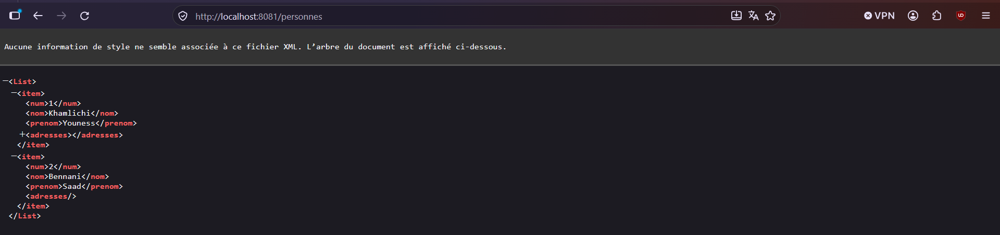
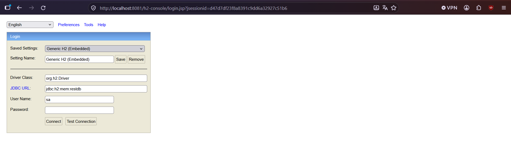
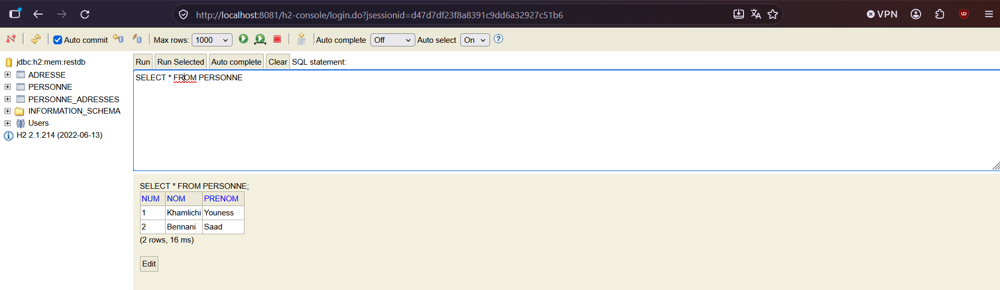
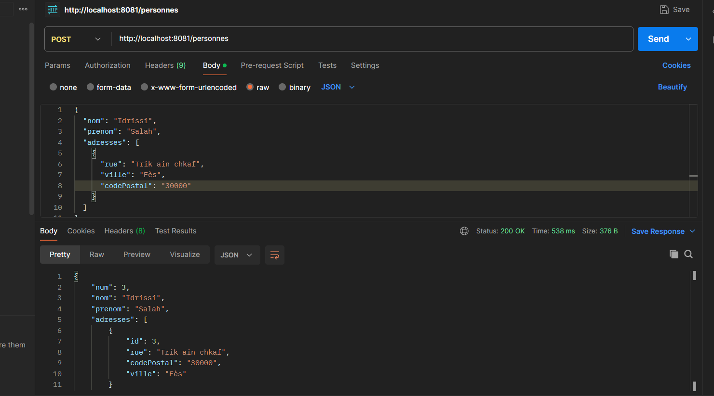
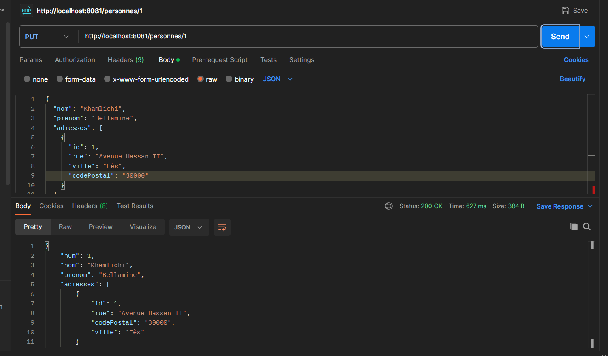
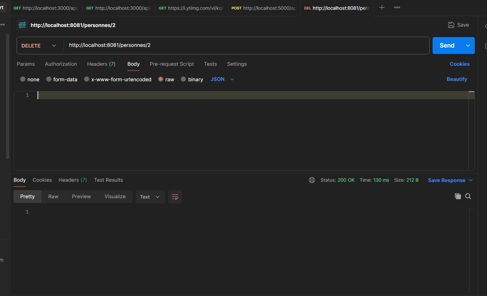
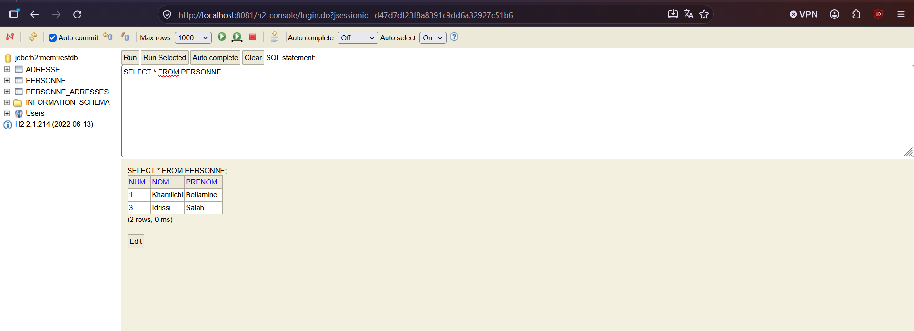

# Exemple du cours: Spring Boot - REST API & Association @ManyToMany

Ce projet met en œuvre un service Web RESTful avec Spring Boot, JPA et H2, gérant les entités `Personne` et `Adresse`.

## Tests & Résultats

Les images ci-dessous sont stockées dans le dossier `screenshots/` à la racine de ce sous-projet.

### 1. Test du Endpoint REST via le Navigateur (Format XML)
Accès à l'URL `http://localhost:8081/personnes`. Par défaut, sans en-tête d'acceptation spécifique, Spring Boot retourne le flux XML d'initialisation des personnes.

---

### 2. Interface de Connexion à la Console H2
Accès à la console d'administration H2 via `http://localhost:8081/h2-console` avec la chaîne JDBC `jdbc:h2:mem:restdb`.

---

### 3. Consultation Initiale de la Base de Données
Exécution de la requête SQL `SELECT * FROM PERSONNE;` après le démarrage de l'application. On observe les données de test injectées au lancement.

---

### 4. Ajout d'une Personne avec son Adresse (Requête `POST`)
Test avec **Postman** de l'ajout d'une nouvelle personne (*Salah Idrissi*) avec son adresse associée (*Trik ain chkaf, Fès*). Le serveur retourne l'objet créé avec le code de statut `200 OK`.

---

### 5. Modification d'une Personne Existante (Requête `PUT`)
Mise à jour des informations de la personne `id = 1` (*Youness Khamlichi*) vers *Bellamine* et affectation de la nouvelle adresse (*Avenue Hassan II, Fès*).

---

### 6. Suppression d'une Personne (Requête `DELETE`)
Suppression de la personne avec l'identifiant `2` (*Saad Bennani*). La réponse HTTP retourne le code `200 OK`.

---

### 7. Vérification Finale de l'État de la Base de Données
Consultation finale dans la console H2 pour confirmer la prise en compte de toutes les opérations effectuées (mise à jour de la personne 1, ajout de la personne 3 et suppression de la personne 2).

