# TP 1 : Application de Gestion de Stock de Pharmacie (Spring Boot, JPA, Thymeleaf & REST API)

Ce projet est une application distribuée de gestion du stock d'une pharmacie développée dans le cadre du module **Spring Boot - Microservices** à l'**ENSA de Fès**.

Elle met en œuvre la persistance des données avec **Spring Data JPA**, la gestion des relations ORM complexes (`@OneToOne`, `@OneToMany`, `@ManyToMany`), un affichage dynamique côté client avec **Thymeleaf**, et des API REST de consultation et manipulation testées via **Postman**.

---

## Modèle de Données & Architecture

L'application repose sur les entités principales suivantes :
- **Produit** : Entité centrale possédant des relations avec toutes les autres entités.
- **Categorie** : Relation `@OneToMany` avec `Produit` (Une catégorie contient plusieurs produits).
- **Fournisseur** : Relation `@OneToMany` avec `Produit` (Un fournisseur fournit plusieurs produits).
- **DetailProduit** : Relation `@OneToOne` avec `Produit` (Détails de composition, fabricant et posologie).
- **Tag** : Relation `@ManyToMany` avec `Produit` via la table de jonction `produit_tag`.

---

## Execution & Tests de l'Application

Toutes les captures d'écran ci-dessous sont issues des tests réels de l'application et sont stockées dans le dossier `screenshots/` à la racine du projet.

### 1. Vérification de la Structure de la Base de Données (MySQL)
Après le démarrage de l'application Spring Boot, Hibernate génère automatiquement les tables dans la base de données MySQL `pharmacie_db`. On retrouve la table centrale `produit`, les tables d'associations et la table de jonction `produit_tag`.
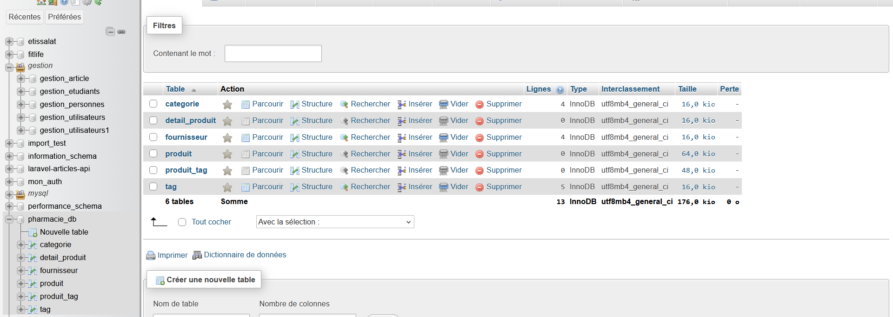

---

### 2. Affichage Initial des Produits via Thymeleaf
Consultation de l'interface Web à l'adresse `http://localhost:8081/produits`. L'application affiche la liste initiale des produits injectés au démarrage avec leurs catégories, fournisseurs, détails de fabrication et tags associés.
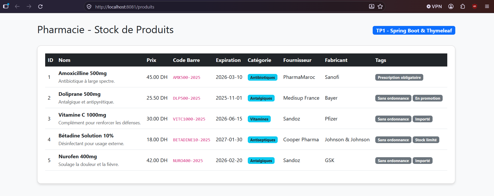

---

### 3. Consultation d'un Produit Spécifique via l'API REST (POSTMAN)
Exécution d'une requête `GET` sur l'endpoint `http://localhost:8081/api/produits/5` pour récupérer les détails complets du produit *Nurofen 400mg* au format JSON. Le serveur retourne un code de statut `200 OK`.
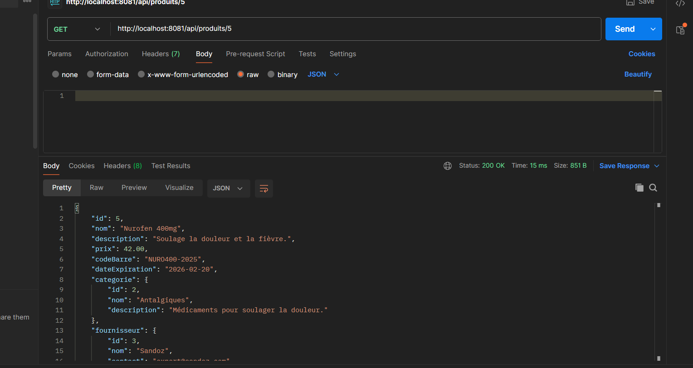

---

### 4. Ajout d'un Nouveau Produit via l'API REST (`POST`)
²Envoi d'une requête `POST` sur `http://localhost:8081/api/produits` pour insérer un nouveau produit (*Paracétamol 1000mg*) avec sa catégorie, son fournisseur, son détail produit et son tag. Le serveur confirme la création avec le statut `201 Created` et attribue l'identifiant `6`.
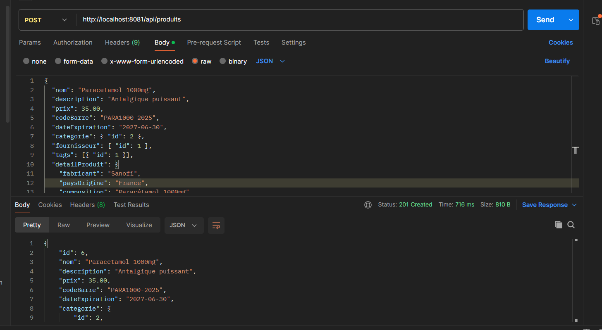

---

### 5. Vérification de l'Ajout sur l'Interface Web Thymeleaf
Actualisation de la page `http://localhost:8081/produits` dans le navigateur pour s'assurer que le nouveau produit inséré via l'API REST (*Paracétamol 1000mg*, ID = 6, Prix = 35.00 DH) apparaît bien dans la liste.
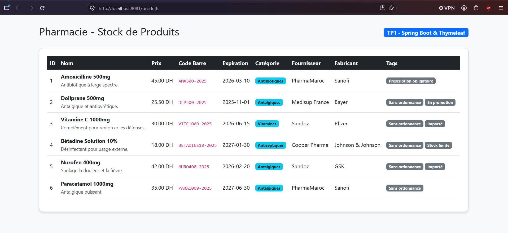

---

### 6. Modification d'un Produit Existant via l'API REST (`PUT`)
Envoi d'une requête `PUT` sur `http://localhost:8081/api/produits/6` pour mettre à jour les données du produit nouvellement créé (mise à jour du prix à `59.00 DH`). Le serveur confirme la modification avec le statut `200 OK`.
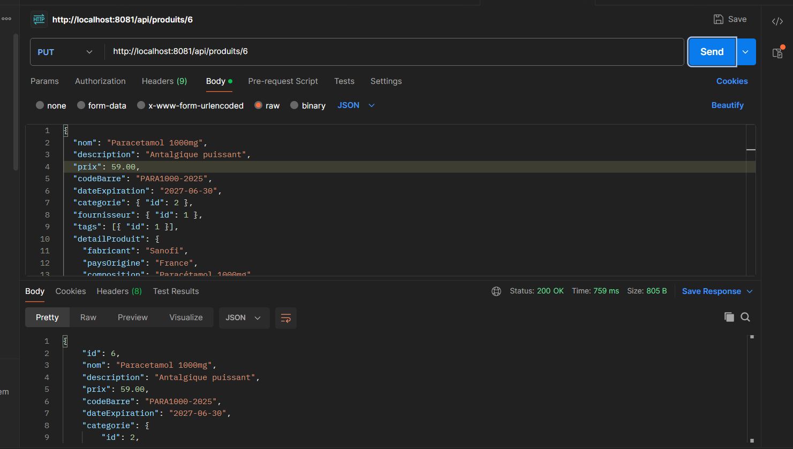

---

### 7. Vérification de la Modification sur l'Interface Web Thymeleaf
Consultation de l'interface Thymeleaf pour vérifier la mise à jour effective en base de données. On constate bien que le prix du produit ID 6 est passé à `59.00 DH`.
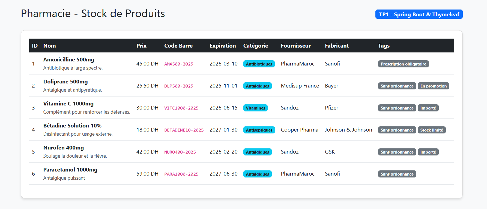

---

### 8. Suppression d'un Produit via l'API REST (`DELETE`)
Envoi d'une requête `DELETE` sur `http://localhost:8081/api/produits/6` pour supprimer le produit de la base de données. Le serveur retourne le statut `204 No Content`, confirmant la suppression réussie.
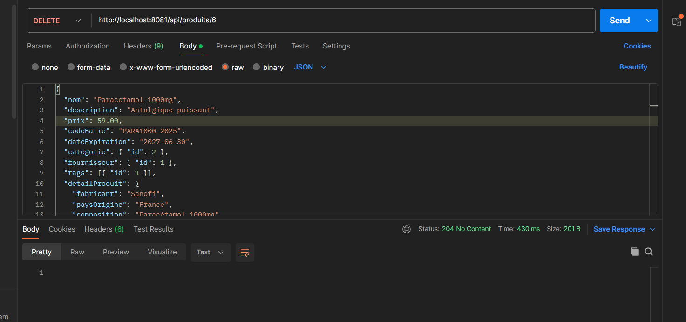

---

### 9. Consultation des Fournisseurs via l'API REST
Test de l'endpoint `http://localhost:8081/api/fournisseurs` via une requête `GET` dans Postman pour afficher la liste de tous les fournisseurs enregistrés ainsi que leurs produits associés.
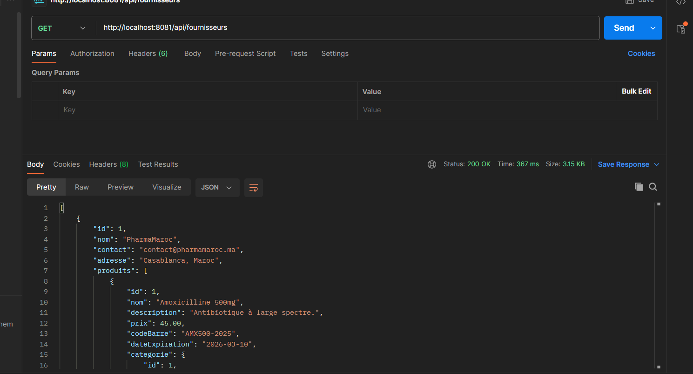

---

### 10. Consultation des Tags via l'API REST
Test de l'endpoint `http://localhost:8081/api/tags` via une requête `GET` dans Postman pour lister les étiquettes de classification (*Sans ordonnance*, *Prescription obligatoire*, etc.) et les produits liés.
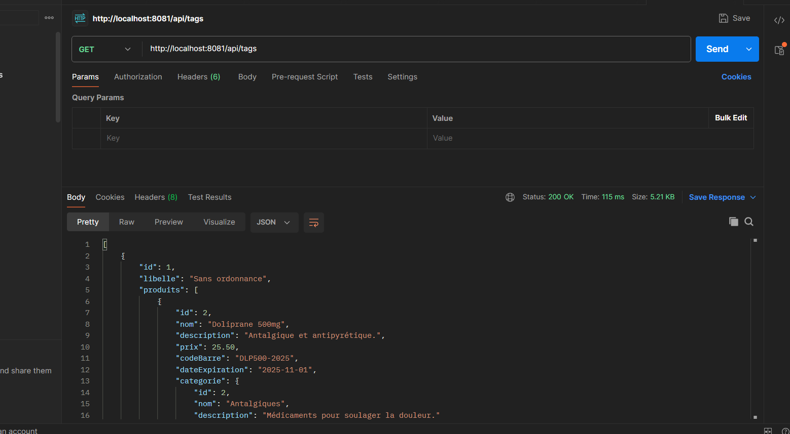

---

### 11. Consultation des Catégories via l'API REST
Test de l'endpoint `http://localhost:8081/api/categories` via une requête `GET` dans Postman pour récupérer l'ensemble des catégories de médicaments et la liste des produits qui y sont rattachés.
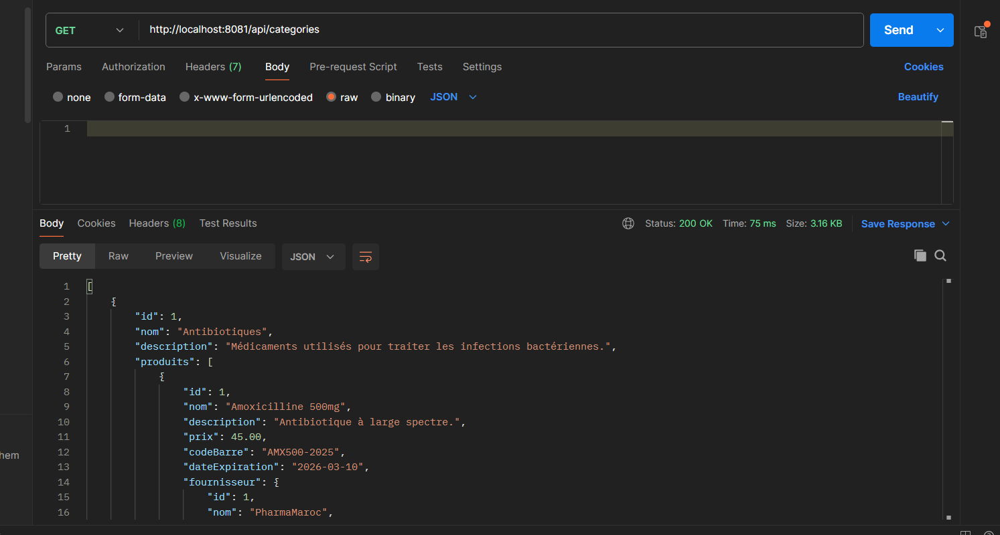